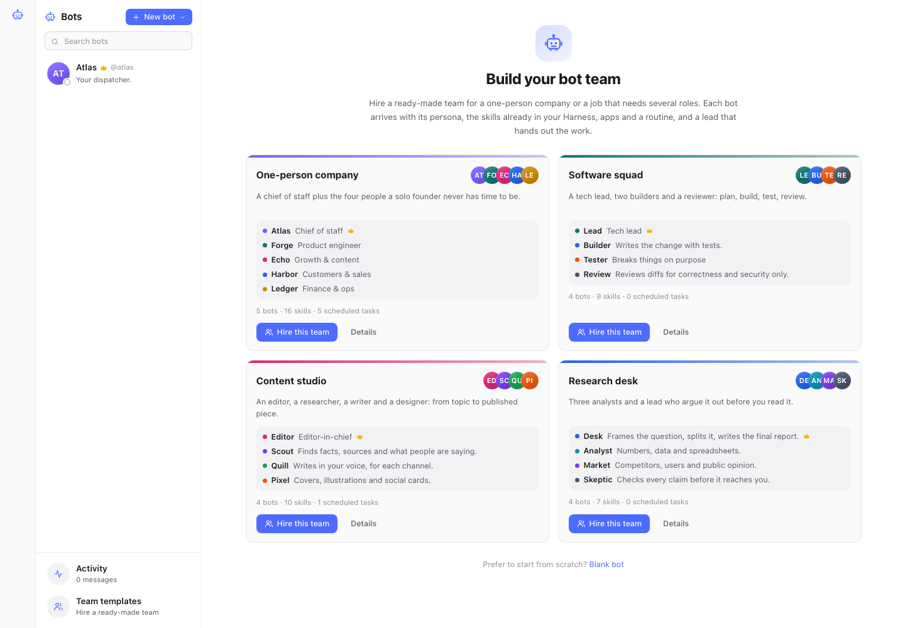

# Bots

English | [简体中文](README.zh-CN.md)

Grok-style bots inside DeepSeek Harness: a team of bots that work together. Each bot has its own **avatar,
persona, skills, abilities, apps and scheduled tasks**, and its own conversation. Bots **message each
other**, and one of them, the **dispatcher**, splits the work, hands it out, follows up and reports back.

It is built for two situations:

- **A one-person company (OPC)**: you run a business alone and need a whole staff — engineering, growth,
  customers, finance — plus a chief of staff who briefs you every morning.
- **Work that is naturally split between roles**: code needs a builder, a tester and a reviewer; content
  needs a researcher, a writer and a designer; research needs a skeptic.



## Hire a whole team in one click

Open the Bots panel (sidebar, or `/bots`), pick a team template and click **Hire this team**:

| Team | Members | Scheduled tasks it comes with |
| --- | --- | --- |
| **One-person company** | Atlas (chief of staff, dispatcher), Forge (engineer), Echo (growth), Harbor (customers), Ledger (finance) | Weekday 09:00 morning brief, Friday 17:30 weekly review, Monday market pulse, weekday inbox sweep, Monday numbers |
| **Software squad** | Lead, Builder, Tester, Review | — |
| **Content studio** | Editor, Scout (research), Quill (writer), Pixel (design) | Monday topic planning |
| **Research desk** | Desk (lead), Analyst, Market, Skeptic | — |

Hiring:

- creates the bots with bilingual personas, in your UI language;
- gives each member **the skills already installed in your Harness** that fit its role (deep-research,
  last30days, xlsx, high-signal-review, …), skipping and reporting any you don't have;
- imports role skills from [anthropics/skills](https://github.com/anthropics/skills) (webapp-testing,
  frontend-design, brand-guidelines, …) with their scripts;
- adds the apps the role needs (GitHub, Stripe, HubSpot, …), whose keys you fill in later;
- schedules the team's recurring tasks and makes its lead the dispatcher;
- offers to send the lead a kickoff message, so the team starts working right away.


## An example (one-person company)

> **You → Atlas**: We release the new version next week. Organise it.
>
> **Atlas → Forge**: Fix the three P1 bugs before release, review your own diff, merge by Wednesday.
>
> **Atlas → Echo**: Draft the launch post and three social posts in the founder's voice, by Thursday.
>
> **Atlas → Ledger**: For a week after release, check new subscriptions and refunds daily; flag anything odd.
>
> **Forge → Atlas**: The three bugs are fixed, tests pass, PR merged.
>
> **Atlas → You**: This week: bugs cleared; launch draft for your review tomorrow. Decision needed: do we raise the price?

Bots answer in the language you write in, so the same team works in Chinese and English
([中文示例](README.zh-CN.md#一段示例一人公司)).

## Built on what Harness already does

A bot is an ordinary Harness conversation, so everything Harness can do, a bot can do:

- **Abilities**: web search, files, running commands and code, Office documents, image generation,
  sub-agents and workflows, handing over files… switched per bot on its Profile tab (a reviewer bot
  that cannot run commands, for instance).
- **Skills**:
  - **Add from Harness**: pick from the skills you already installed (`~/.agents/skills`,
    `~/.dsh/skills`, …); referenced, not copied, so they stay up to date;
  - **Import from GitHub**: browse Anthropic's skills in one click, or paste any `owner/repo/path`; the
    whole skill folder comes along, scripts included;
  - **Let the bot write it**: describe what you need in a sentence; the bot writes it with skill-creator
    and saves it to itself;
  - writing one by hand is still possible, as the last resort.
- **Apps** add only the outside systems Harness doesn't reach on its own:
  - **Import from your other agents**: MCP servers you already configured in Codex, Claude Code,
    Claude Desktop, Cursor, Windsurf, Gemini CLI or opencode are found automatically; tick them,
    keys included;
  - **the gallery**:

| Category | Apps (🔑 = needs a key) |
| --- | --- |
| Sales & payments | Stripe 🔑, HubSpot CRM 🔑 |
| Team & office | Telegram 🔑 and Discord 🔑 (chat apps, below), Feishu / Lark 🔑, Notion 🔑, Slack 🔑, Memory |
| Build & ship | GitHub 🔑, Git, Supabase 🔑, Sentry 🔑, Context7 Docs |
| Research & content | Exa, Tavily 🔑, Brave 🔑, Firecrawl 🔑 |
| Computer & browser | Open Computer Use (operate macOS apps), Playwright |
| Data | PostgreSQL 🔑, SQLite |
| Maps & local | Amap 🔑, Baidu Maps 🔑 |
| Custom | Any local (stdio) or remote (Streamable HTTP) MCP server |

- **Schedules** are ordinary Harness scheduled tasks, also on the Automation page.
- **AI avatars**: with the [Images plugin](../images), draw a bot's avatar from its persona.
- **Logos**: each app in the gallery shows its vendor's own logo (the App Store icon where there is an app,
  otherwise the logo from the vendor's site or repository). The logos are their owners' trademarks and
  only identify each service.

## Message your team from Telegram or Discord

Add **Telegram** or **Discord** to a bot (normally the dispatcher) in its **Apps** tab, and you can hand out
work from your phone: what you send the chat bot goes to the team as if you typed it in the panel, and
the replies come back to the chat, including the dispatcher's report once its teammates have answered.

> **You, in Telegram**: Get the release organised for next week.
>
> **Atlas**: On it: Forge takes the three P1 bugs, Echo drafts the launch post.
>
> **Atlas** (later): Bugs fixed and merged; the launch draft is ready for your review.

### Telegram

1. In Telegram, open [@BotFather](https://t.me/BotFather), send `/newbot`, pick a name and a username
   ending in `bot`. Make a new bot just for this team.
2. In Bots, open the dispatcher → **Apps** → **Telegram** → paste the token BotFather gave you → **Add**.
   It connects at once and shows **Connected as @yourbot**.
3. Pair yourself: the panel shows a one-time code (it works once, for 10 minutes). Click **Open in
   Telegram** and press **Start**, or send the code to your bot. The bot answers "Paired".
4. Message the bot. Start a message with `@handle` to reach another bot directly (`@forge fix the login bug`).
   In a group, add the bot and @mention it (or reply to it); it ignores the rest of the conversation.

### Discord

1. In the [Developer Portal](https://discord.com/developers/applications): **New Application** → **Bot** →
   **Reset Token** and copy it. On the same page turn on **Message Content Intent** (without it the bot
   cannot read messages, and the panel says so).
2. Add **Discord** to the dispatcher with that token. Once connected, use **Invite the bot to a server**
   (any server you are in, a private one is fine): Discord only lets you DM a bot you share a server with.
3. DM the bot the pairing code, then DM it your requests, or @mention it in a channel.

### What else to know

- **Who can talk to it**: only people you paired. Anyone else is ignored; in a private chat they get at
  most one "this bot is private" line a day. Pairing happens only in a private chat, with the current
  code, and a few wrong guesses lock a person out until the next code. You can pair more people (each
  needs a new code) and remove anyone from the panel; the panel also counts ignored messages.
- **Treat a pairing like your own login**: a paired person can ask the bots for anything you could,
  including whatever their abilities and apps allow on this Mac. Pair only yourself or people you trust,
  and turn off risky abilities on the bot that owns the channel if others are paired.
- **Where replies go**: to the chat your latest request came from. Write in the panel and the conversation
  is back in the panel. Telegram gets plain text (Markdown markers removed); Discord keeps its Markdown.
- **Scheduled reports**: a scheduled task of the bot that owns the channel reports to the first paired
  person (switch it off in the panel), so "every weekday at nine Atlas briefs you" lands on your phone.
- **One token, one place**: a chat bot token can be connected on one bot of one Harness at a time. If
  another program uses the same Telegram token, the panel says so.
- The token is stored with the bot like other app keys, never shown back in the panel, and kept out of
  logs and error messages. Harness must be running for the bot to answer; Telegram holds messages for up
  to 24 hours, and a message is never run twice after a restart.

## How it works

- Each bot owns one ordinary Harness conversation, in the **Bots** workspace (`~/.dsh/bots/workspace`
  unless `workdir` is set).
- When it runs, the bot's persona and the team roster join its system prompt; its own skills, ability
  limits and apps apply to that conversation only. Edits apply at once; a new or changed app connects
  the next time the conversation starts.
- `bot_send_message` puts the text into the other bot's inbox and wakes it. Two bots may exchange at
  most 16 messages in 10 minutes, so conversations end.
- Every conversation gets `bot_list`, `bot_create`, `bot_update`, `bot_delete`, `bot_send_message`
  and `bot_schedule` to manage bots.
- A chat app is not an MCP server: the Host keeps one connection per Telegram or Discord app (long polling
  for Telegram, the gateway for Discord), starts and stops it as you add, change, switch off or remove the
  app, and hands paired people's messages to the bot as user prompts headed `[Telegram · Name]`.

## Open Computer Use

[open-computer-use](https://github.com/kadaliao/open-computer-use) lets a bot operate macOS apps through
the accessibility tree. Click **Install now** on its card, then grant **DeepSeek Harness** Accessibility
permission and restart it.

## What it stores and sends

- `~/.dsh/cache/bots/`: `bots.json` (bots, including keys and chat bot tokens entered for apps),
  `messages.jsonl` (timeline), `channels.json` (paired people per chat app, and the last message handled
  per chat), `avatars/`, `skills/` (skills imported from GitHub).
- Nothing leaves your machine except through the bots' own conversations (your configured model), the
  apps you connect, the image model when you generate an avatar, GitHub when you import skills, and the
  Telegram or Discord API when you connect a chat app (the bots' replies to paired people, typing
  indicators, and the one-line note to strangers).

## Install

Add this repository's index in DeepSeek Harness (**Plugins → Discover → Sources**):

```
https://raw.githubusercontent.com/kadaliao/dsh-plugins/main/marketplace.json
```

then install **Bots**. The Discover tab is part of the experimental **Custom plugin markets**
feature; turn it on under **Plugins → Experimental plugins** if you don't see it.

Without Discover, paste the Git spec into the plugin manager:

```
git+https://github.com/kadaliao/dsh-plugins.git#main&path:/plugins/bots
```

Refresh the page once after installing. For AI avatars, install [Images](../images) too.

## Limits

- Web UI only.
- Group chats between bots are not there yet; bots collaborate through direct messages.
- Harness skills a team template names that you don't have are skipped; import them from GitHub or have
  the bot write them later.
