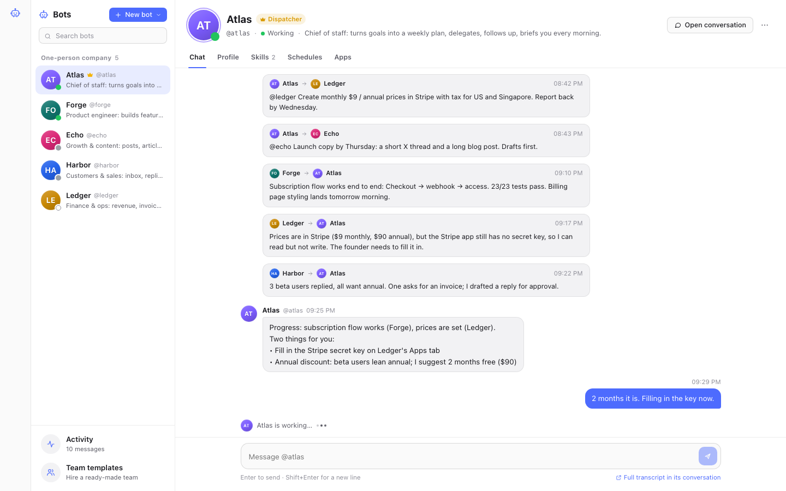

# Bots

English | [简体中文](README.zh-CN.md)

Grok-style bots inside DeepSeek Harness: a team of bots that work together. Each bot has its own **avatar,
persona, model, skills, abilities, apps, scheduled tasks and memory**, and its own conversation. Bots **message each
other**, and one of them, the **dispatcher**, splits the work, hands it out, follows up and reports back.

It is built for two situations:

- **A one-person company (OPC)**: you run a business alone and need a whole staff — engineering, growth,
  customers, finance — plus a chief of staff who briefs you every morning.
- **Work that is naturally split between roles**: code needs a builder, a tester and a reviewer; content
  needs a researcher, a writer and a designer; research needs a skeptic.


## Hire a whole team in one click

Open the Bots panel (sidebar, or `/bots`), pick a team template and click **Hire this team**:

| Team | Members | Scheduled tasks it comes with |
| --- | --- | --- |
| **One-person company** | Atlas (chief of staff, dispatcher), Forge (engineer), Echo (growth), Harbor (customers), Ledger (finance) | Weekday 09:00 morning brief, Friday 17:30 weekly review, Monday market pulse, weekday inbox sweep, Monday numbers |
| **Software squad** | Lead, Builder, Tester, Review | — |
| **Content studio** | Editor, Scout (research), Quill (writer), Pixel (design) | Monday topic planning |
| **Research desk** | Desk (lead), Analyst, Market, Skeptic | — |

Hiring:

- creates the bots with bilingual personas, in your UI language;
- gives each member **the skills already installed in your Harness** that fit its role (deep-research,
  last30days, xlsx, high-signal-review, …), skipping and reporting any you don't have;
- imports role skills from [anthropics/skills](https://github.com/anthropics/skills) (webapp-testing,
  frontend-design, brand-guidelines, …) with their scripts;
- adds the apps the role needs (GitHub, Stripe, HubSpot, …), whose keys you fill in later;
- schedules the team's recurring tasks and makes its lead the dispatcher;
- offers to send the lead a kickoff message, so the team starts working right away.



## An example (one-person company)

> **You → Atlas**: We release the new version next week. Organise it.
>
> **Atlas → Forge**: Fix the three P1 bugs before release, review your own diff, merge by Wednesday.
>
> **Atlas → Echo**: Draft the launch post and three social posts in the founder's voice, by Thursday.
>
> **Atlas → Ledger**: For a week after release, check new subscriptions and refunds daily; flag anything odd.
>
> **Forge → Atlas**: The three bugs are fixed, tests pass, PR merged.
>
> **Atlas → You**: This week: bugs cleared; launch draft for your review tomorrow. Decision needed: do we raise the price?

Bots answer in the language you write in, so the same team works in Chinese and English
([中文示例](README.zh-CN.md#一段示例一人公司)).

## Built on what Harness already does

A bot is an ordinary Harness conversation, so everything Harness can do, a bot can do:

- **Abilities**: web search, files, running commands and code, Office documents, image generation,
  sub-agents and workflows, handing over files… switched per bot on its Profile tab (a reviewer bot
  that cannot run commands, for instance).
- **Skills**:
  - **Add from Harness**: pick from the skills you already installed (`~/.agents/skills`,
    `~/.dsh/skills`, …); referenced, not copied, so they stay up to date;
  - **Import from GitHub**: browse Anthropic's skills in one click, or paste any `owner/repo/path`; the
    whole skill folder comes along, scripts included;
  - **Add from a folder**: pick a skill folder on this machine (or a folder holding several, e.g.
    `~/.claude/skills`); linked, not copied, so editing the folder is enough;
  - a skill name is used once per bot: adding one that is already there is skipped, and importing again
    from the same GitHub folder updates it in place;
  - up to 50 skills can be on at once (each one on is in the bot's prompt every turn); a bot keeps up to
    200 in all, so past 50 new ones come in switched off;
  - **Let the bot write it**: describe what you need in a sentence; the bot writes it with skill-creator
    and saves it to itself;
  - writing one by hand is still possible, as the last resort.
- **Apps** add only the outside systems Harness doesn't reach on its own:
  - **Import from your other agents**: MCP servers you already configured in Codex, Claude Code,
    Claude Desktop, Cursor, Windsurf, Gemini CLI or opencode are found automatically; tick them,
    keys included;
  - **the gallery**:

| Category | Apps (🔑 = needs a key) |
| --- | --- |
| Sales & payments | Stripe 🔑, HubSpot CRM 🔑 |
| Team & office | Feishu / Lark 🔑, Telegram 🔑, Slack 🔑 and Discord 🔑 (chat apps, below), Feishu / Lark Open Platform 🔑, Notion 🔑, Slack workspace 🔑, Memory |
| Build & ship | GitHub 🔑, Git, Supabase 🔑, Sentry 🔑, Context7 Docs |
| Research & content | Exa, Tavily 🔑, Brave 🔑, Firecrawl 🔑 |
| Computer & browser | Open Computer Use (operate macOS apps), Playwright |
| Data | PostgreSQL 🔑, SQLite |
| Maps & local | Amap 🔑, Baidu Maps 🔑 |
| Custom | Any local (stdio) or remote (Streamable HTTP) MCP server |

- **Schedules** are ordinary Harness scheduled tasks, also on the Automation page.
- **AI avatars**: with the [Images plugin](../images), draw a bot's avatar from its persona.
- **Logos**: each app in the gallery shows its vendor's own logo (the App Store icon where there is an app,
  otherwise the logo from the vendor's site or repository). The logos are their owners' trademarks and
  only identify each service.

## Each bot on its own model

A bot's **Profile → Model** picks the model its conversation runs on, grouped by provider, with the
model's thinking levels when it has them. Besides the models Harness already has, **Model sources** adds:

- **Your own endpoint**: any OpenAI-compatible (Chat Completions or Responses), Anthropic-compatible or
  Gemini base URL, a key and model ids (or **Fetch models** to tick them from the endpoint's list). It
  becomes a Harness provider `bots-<name>`, its key in the Harness credential store, so it also shows up in
  Settings → Models and in every conversation.
- **A login another agent on this computer already has**: the Codex CLI's ChatGPT login
  (`~/.codex/auth.json`) becomes Harness's `openai-codex` provider. OpenAI rotates the login on every
  refresh, so the two copies are kept in sync both ways — whichever side refreshes, the other gets the new
  tokens, and neither signs the other out. Claude Code's login is shown but not offered: Anthropic allows a
  Claude subscription only in Claude Code and claude.ai, so add Claude with an API key instead.

## Topics: conversations that don't grow forever

A bot's conversation is a **topic**. A new topic is a fresh conversation (the old one is archived, the
bot's scheduled tasks move along); what the bot knows carries over in its memory. A new topic starts:

- when you send `/new` (or `/clear`, `/新话题`) in the panel or from a chat app — text after it goes to the
  new topic — or click **New topic** under the composer;
- by itself before the next task, after **6 hours** of quiet, or once the conversation's prompt reached
  **128K tokens** (Settings; 0 turns either off). A big conversation is never cut while a teammate's
  answer may still be coming.

Harness still compacts a conversation that nears the model's limit; topics keep every call small and cheap
long before that.

## Memory

Every bot keeps **notes** that outlast its topics, and the team shares one more list every bot reads:

- **After every task** a short model call writes one line to the bot's **journal** (what was asked, what
  came of it) and adds, corrects or removes notes — preferences, people, decisions, procedures, lessons.
  Facts every bot should know go to the team notes.
- **The bot itself** saves notes with `memory_save` when you tell it to remember something, removes them
  with `memory_forget`, and looks through notes, the team journal and digests with `memory_search`.
- **Every night** (03:00 by default) memory is **consolidated**: each bot's notes are merged, corrected
  and trimmed with its recent journal, the shared notes too, and the day's work is written up as the
  team's **daily digest**. **Consolidate now** runs it at once.
- A bot reads its notes, the team notes, its last few journal lines and the latest digest when a topic
  starts, and again at the next task after you edit memory or the nightly consolidation ran. Within a
  topic the memory part of its prompt stays the same, so the model's prompt cache over the conversation
  keeps working (what it learns in a topic is in that conversation anyway). A short exchange — an
  acknowledgement, a one-line answer to a teammate — gets a journal line without a model call.
- The **Memory** tab of a bot and **Team memory** in the sidebar show everything; add, edit, pin or
  delete notes there. Pinned notes are never changed by the automatic passes. Text that looks like a key
  or token is never stored.
- Memory work runs on each bot's own model unless Settings names a cheaper one.

## Usage

**Usage** in the sidebar counts every model call the bots make — their conversations, the memory work and
Harness compacting their context — by bot, task, model, kind of work, scheduled task and day (or hour,
for today), with the change from the period before. A **task** is everything a bot does from one request
(you, a chat app, a schedule or another bot) until it is idle again. Costs are estimates from your own
prices or LiteLLM's public price list (**Prices**); a model with no price shows its tokens only.

## Message your team from Feishu, Telegram, Slack or Discord

Add **Feishu / Lark**, **Telegram**, **Slack** or **Discord** to a bot (normally the dispatcher) in its **Apps** tab, and you can hand out
work from your phone: what you send the chat bot goes to the team as if you typed it in the panel, and
the replies come back to the chat, including the dispatcher's report once its teammates have answered.

> **You, in Telegram**: Get the release organised for next week.
>
> **Atlas**: On it: Forge takes the three P1 bugs, Echo drafts the launch post.
>
> **Atlas** (later): Bugs fixed and merged; the launch draft is ready for your review.

### Telegram

1. In Telegram, open [@BotFather](https://t.me/BotFather), send `/newbot`, pick a name and a username
   ending in `bot`. Make a new bot just for this team.
2. In Bots, open the dispatcher → **Apps** → **Telegram** → paste the token BotFather gave you → **Add**.
   It connects at once and shows **Connected as @yourbot**.
3. Pair yourself: the panel shows a one-time code (it works once, for 10 minutes). Click **Open in
   Telegram** and press **Start**, or send the code to your bot. The bot answers "Paired".
4. Message the bot. Start a message with `@handle` to reach another bot directly (`@forge fix the login bug`).
   In a group, add the bot and @mention it (or reply to it); it ignores the rest of the conversation.

### Discord

1. In the [Developer Portal](https://discord.com/developers/applications): **New Application** → **Bot** →
   **Reset Token** and copy it. On the same page turn on **Message Content Intent** (without it the bot
   cannot read messages, and the panel says so).
2. Add **Discord** to the dispatcher with that token. Once connected, use **Invite the bot to a server**
   (any server you are in, a private one is fine): Discord only lets you DM a bot you share a server with.
3. DM the bot the pairing code, then DM it your requests, or @mention it in a channel.

### Feishu / Lark

Feishu uses its long connection: the Harness connects out to Feishu, so your computer needs no public
address. The same steps work for Lark; the panel finds out which one your app belongs to.

1. Open the developer console at https://open.feishu.cn/app (Lark: https://open.larksuite.com/app) and
   **Create Custom App**.
2. **Add Features** → **Bot**.
3. **Permissions & Scopes** (**Batch import/export scopes** accepts the JSON below):
   - required: `im:message.p2p_msg:readonly`, `im:message.group_at_msg:readonly`, `im:message:send_as_bot`
   - optional: `contact:contact.base:readonly` + `contact:user.base:readonly` (sender names),
     `im:message.reactions:write_only` (a "Typing" reaction while the team works), `im:chat:readonly` (group names)
4. Copy the **App ID** and **App Secret** from **Credentials & Basic Info** into the bot's **Apps** →
   **Feishu / Lark**, and save. The long connection comes up. If the panel asks you to turn on the bot,
   that only means no version is published yet; the connection is already online.
5. With the Harness running, go to **Events & Callbacks** → **Event Configuration**, set the subscription
   mode to **Receive events through persistent connection** and save. The console only accepts this while
   a connection is online.
6. **Add Events** → `im.message.receive_v1`.
7. **Version Management & Release** → create a version whose availability includes the people who will
   use it, and publish (an admin may need to approve).
8. In Feishu, open a chat with the bot (search for the app, or use **Open in Feishu** in the panel) and
   send the pairing code. For a group, add the bot to the group and @ it.

Use an app made for this team only: when several programs connect with the same App ID, Feishu hands each
message to just one of them.

```json
{"scopes":{"tenant":["im:message.p2p_msg:readonly","im:message.group_at_msg:readonly","im:message:send_as_bot","im:message.reactions:write_only","contact:contact.base:readonly","contact:user.base:readonly","im:chat:readonly"],"user":[]}}
```

### Slack

Slack uses Socket Mode: the Harness connects out to Slack, so your computer needs no public address.

1. Open https://api.slack.com/apps → **Create New App** → **From a manifest**, pick your workspace, choose
   the JSON tab and paste the manifest below (rename "Bot Team" if you like) → **Next** → **Create**.
2. **Install App** → **Install to Workspace** → **Allow**. Copy the **Bot User OAuth Token** (`xoxb-…`).
3. **Basic Information** → **App-Level Tokens** → **Generate Token and Scopes**: any name, **Add Scope** →
   `connections:write`, **Generate**, and copy the token (`xapp-…`).
4. In Bots, open the bot → **Apps** → add **Slack**, paste both tokens and save. Once it shows
   *Connected*, a pairing code appears.
5. In Slack, open the app (**Open in Slack** next to the code, or Apps → your app → Messages) and send it
   the code.
6. To use it in a channel, invite the app (`/invite @Bot Team`) and @mention it; it answers in the thread.

Use one Slack app per bot, and don't run the same app in another program: Slack hands each message to only
one connection. If you change scopes later, reinstall the app to the workspace and press **Reconnect**.

```json
{
  "display_information": {
    "name": "Bot Team",
    "description": "Message your bot team from Slack: DM the app, or @mention it in a channel.",
    "background_color": "#4a154b"
  },
  "features": {
    "app_home": { "home_tab_enabled": false, "messages_tab_enabled": true, "messages_tab_read_only_enabled": false },
    "bot_user": { "display_name": "Bot Team", "always_online": true }
  },
  "oauth_config": {
    "scopes": { "bot": ["app_mentions:read", "channels:read", "chat:write", "groups:read", "im:history", "users:read"] }
  },
  "settings": {
    "event_subscriptions": { "bot_events": ["app_mention", "message.im"] },
    "org_deploy_enabled": false,
    "socket_mode_enabled": true,
    "token_rotation_enabled": false
  }
}
```

### What else to know

- **Who can talk to it**: only people you paired. Anyone else is ignored; in a private chat they get at
  most one "this bot is private" line a day. Pairing happens only in a private chat, with the current
  code, and a few wrong guesses lock a person out until the next code. You can pair more people (each
  needs a new code) and remove anyone from the panel; the panel also counts ignored messages.
- **Treat a pairing like your own login**: a paired person can ask the bots for anything you could,
  including whatever their abilities and apps allow on this Mac. Pair only yourself or people you trust,
  and turn off risky abilities on the bot that owns the channel if others are paired.
- **Where replies go**: to the chat your latest request came from. Write in the panel and the conversation
  is back in the panel. Telegram gets plain text (Markdown markers removed); Discord, Slack and Feishu
  show the Markdown. In a Slack channel the answer goes into the thread of your message.
- **Scheduled reports**: a scheduled task of the bot that owns the channel reports to the first paired
  person (switch it off in the panel), so "every weekday at nine Atlas briefs you" lands on your phone.
- **One token, one place**: a chat bot token can be connected on one bot of one Harness at a time. If
  another program uses the same Telegram token, the panel says so.
- The token is stored with the bot like other app keys, never shown back in the panel, and kept out of
  logs and error messages. Harness must be running for the bot to answer; Telegram holds messages for up
  to 24 hours, and a message is never run twice after a restart.

## How it works

- Each bot owns one ordinary Harness conversation, in the **Bots** workspace (`~/.dsh/bots/workspace`
  unless `workdir` is set).
- When it runs, the bot's persona and the team roster join its system prompt; its own skills, ability
  limits and apps apply to that conversation only. Edits apply at once; a new or changed app connects
  the next time the conversation starts.
- `bot_send_message` puts the text into the other bot's inbox and wakes it. Two bots may exchange at
  most 16 messages in 10 minutes, so conversations end.
- Every conversation gets `bot_list`, `bot_create`, `bot_update`, `bot_delete`, `bot_send_message`
  and `bot_schedule` to manage bots, and `memory_save`, `memory_forget` and `memory_search`.
- A bot's memory is a section of its system prompt, read when a topic starts (and at the next task after
  a memory edit in the panel or the nightly consolidation), never in the middle of a task. A task ends when the bot's
  Agent is idle; its transcript (prompts, replies, tool calls, short tool results) is what the memory pass
  reads. Usage comes from the `assistant/message` and `compaction/summary` events of the bots'
  conversations, plus the plugin's own memory calls.
- A chat app is not an MCP server: the Host keeps one connection per chat app (long polling for Telegram,
  the gateway for Discord, Socket Mode for Slack, the long connection for Feishu), starts and stops it as you add, change, switch off or remove the
  app, and hands paired people's messages to the bot as user prompts headed `[Telegram · Name]`.

## Open Computer Use

[open-computer-use](https://github.com/kadaliao/open-computer-use) lets a bot operate macOS apps through
the accessibility tree. Click **Install now** on its card, then grant **DeepSeek Harness** Accessibility
permission and restart it.

## What it stores and sends

- `~/.dsh/cache/bots/` (`bots.json` and `channels.json` are readable by your user only): `bots.json` (bots,
  including keys and chat bot tokens entered for apps),
  `messages.jsonl` (timeline), `channels.json` (paired people per chat app, and the last message handled
  per chat), `avatars/`, `skills/` (skills imported from GitHub), `memory/` (notes, journal, digests),
  `usage.jsonl` and `tasks.jsonl` (token counts per call and task, kept 400 days), `topics.json`,
  `settings.json`, `price-catalog.json`.
- Custom endpoints and a borrowed Codex login are written to Harness's own model settings (`llm-pi-ai`) and
  credential store. With the Codex login in use, tokens Harness refreshes are written back to
  `~/.codex/auth.json`.
- Nothing leaves your machine except through the bots' own conversations (your configured model), the
  memory passes (a task's transcript and the bot's notes, to the bot's model or the memory model), the
  LiteLLM price list (downloaded from GitHub weekly), the apps you connect, the image model when you generate an avatar, GitHub when you import skills, and the
  Feishu / Lark, Telegram, Slack or Discord API when you connect a chat app (the bots' replies to paired
  people, typing indicators, and the one-line note to strangers).

## Install

Add this repository's index in DeepSeek Harness (**Plugins → Discover → Sources**):

```
https://raw.githubusercontent.com/kadaliao/dsh-plugins/main/marketplace.json
```

then install **Bots**. The Discover tab is part of the experimental **Custom plugin markets**
feature; turn it on under **Plugins → Experimental plugins** if you don't see it.

Without Discover, paste the Git spec into the plugin manager:

```
git+https://github.com/kadaliao/dsh-plugins.git#main&path:/plugins/bots
```

Refresh the page once after installing. For AI avatars, install [Images](../images) too.

## Limits

- Web UI only.
- Group chats between bots are not there yet; bots collaborate through direct messages.
- Costs are estimates. Gateways, subscriptions and discounts bill differently; set your own prices.
- Only the Codex CLI's login can be borrowed so far; other subscriptions sign in from Harness Settings →
  Models where Harness supports them.
- Harness skills a team template names that you don't have are skipped; import them from GitHub or have
  the bot write them later.
