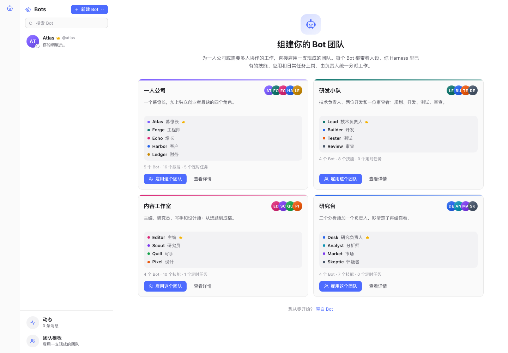

# Bots

[English](README.md) | 简体中文

把 Grok bot 搬进 DeepSeek Harness：一支能互相协作的 bot 团队。每个 bot 有自己的**头像、人设、技能、能力、应用和定时任务**，
也有自己的会话；bot 之间**私信协作**，其中一个是**调度员**，负责拆解任务、分派、跟进、汇报。

它适合两种场景：

- **一人公司（OPC）**：一个人经营业务，需要一整个「员工团队」——研发、增长、客户、财务，再加一个每天早上给你简报的幕僚长。
- **需要分工协作的工作**：开发要有人写、有人测、有人审；内容要有人调研、有人写、有人做图；研究要有人挑刺。



## 一键雇用一支团队

打开 Bots 面板（左侧栏或 `/bots`），挑一个团队模板，点「雇用这个团队」：

| 团队 | 成员 | 自带的定时任务 |
| --- | --- | --- |
| **一人公司** | Atlas 幕僚长（调度员）、Forge 工程师、Echo 增长、Harbor 客户、Ledger 财务 | 工作日 09:00 早间简报、周五 17:30 周复盘、周一市场脉搏、工作日收件箱巡检、周一财务数据 |
| **研发小队** | Lead 技术负责人、Builder 开发、Tester 测试、Review 审查 | — |
| **内容工作室** | Editor 主编、Scout 研究员、Quill 写手、Pixel 设计 | 周一选题会 |
| **研究台** | Desk 研究负责人、Analyst 分析师、Market 市场、Skeptic 怀疑者 | — |

雇用时会：

- 按界面语言创建双语人设的 bot（中文界面就是中文团队）；
- 给每个成员挂上**你这台 Harness 里已有的技能**（如 deep-research、last30days、xlsx、high-signal-review），没装的跳过并告诉你；
- 从 [anthropics/skills](https://github.com/anthropics/skills) 导入岗位需要的技能（如 webapp-testing、frontend-design、brand-guidelines），连同脚本一起下载；
- 加上岗位需要的应用（GitHub、Stripe、HubSpot 等），Key 之后在「应用」页补；
- 建好定时任务，让负责人成为调度员；
- 最后可以一键把「开场任务」发给负责人，团队就开始干活了。


## 一段示例（一人公司）

> **你 → Atlas 幕僚长**：下周要发布新版本，帮我安排一下。
>
> **Atlas → Forge 工程师**：发布前请把 3 个 P1 bug 修完并自审，周三前合并。
>
> **Atlas → Echo 增长**：起草发布公告和三条社媒短帖，用创始人的口吻，周四给我。
>
> **Atlas → Ledger 财务**：发布后一周每天看一下新订阅和退款，有异常立刻告诉我。
>
> **Forge → Atlas**：3 个 bug 已修，测试通过，PR 已合并。
>
> **Atlas → 你**：本周进展：bug 已清零；公告草稿明天给你审；需要你决定：新版本定价是否上调。

bot 默认用你说话的语言回答；中文提问就是中文协作。

## 充分利用 Harness 已有的能力

Bot 就是一个普通的 Harness 会话，所以 Harness 能做的它都能做，不需要重复造轮子：

- **能力**：联网搜索、读写文件、运行命令与代码、Office 文档、AI 作图、子代理与工作流、交付文件……在「资料」页按能力开关，
  比如让审查 bot 不能运行命令；
- **技能**：
  - **从 Harness 添加**：直接选你已经装好的技能（`~/.agents/skills`、`~/.dsh/skills` 等），引用而不复制，跟着更新；
  - **从 GitHub 导入**：一键浏览 Anthropic 官方技能，或粘贴任意 `owner/repo/path`，整个技能文件夹连脚本一起导入；
  - **从本地文件夹添加**：选本机的一个技能文件夹（或装着多个技能的文件夹，如 `~/.claude/skills`），只引用不复制，改了原文件夹就生效；
  - 同一个 bot 里技能不重名：已有的同名技能会跳过；从同一个 GitHub 文件夹再导入一次则原地更新；
  - 最多同时开 50 个技能（开着的每轮都在 bot 的提示里），总共最多放 200 个；超过 50 个时，新加的先关着；
  - **让 Bot 自己写**：一句话描述需求，bot 用 skill-creator 写好并保存到自己身上；
  - 手写仍然可以，但它是最后的选项；
- **应用**：只补 Harness 本身没有的外部系统；
  - **从其他 Agent 导入**：自动发现你在 Codex、Claude Code、Claude Desktop、Cursor、Windsurf、Gemini CLI、opencode 里配好的 MCP 服务，勾选即用，Key 一并带上；
  - **应用库**：

| 分类 | 应用（🔑 = 需要 Key） |
| --- | --- |
| 销售与收款 | Stripe 收款 🔑、HubSpot 客户管理 🔑 |
| 团队与办公 | 飞书 🔑、Telegram 🔑、Slack 🔑、Discord 🔑（聊天应用，见下文）、飞书开放平台 🔑、Notion 🔑、Slack 工作区 🔑、长期记忆 |
| 研发与交付 | GitHub 🔑、Git 仓库、Supabase 🔑、Sentry 🔑、Context7 文档 |
| 调研与内容 | Exa、Tavily 🔑、Brave 🔑、Firecrawl 🔑 |
| 电脑与浏览器 | Open Computer Use（操控 macOS 应用）、Playwright 浏览器 |
| 数据 | PostgreSQL 🔑、SQLite |
| 地图与本地 | 高德地图 🔑、百度地图 🔑 |
| 自定义 | 任意本地（stdio）或远程（Streamable HTTP）MCP 服务 |

- **定时任务**：就是 Harness 的定时任务，也出现在「自动化」页面；
- **AI 头像**：装了 [图片插件](../images) 就能按 bot 的人设生成头像。
- **图标**：应用库里每个应用都用它自己的官方 logo（有 App 的用 App Store 图标，没有的用官网或官方仓库里的 logo）。
  这些 logo 是各自所有者的商标，只用来标明是哪个服务。

## 在飞书、Telegram、Slack 或 Discord 里给团队发消息

在某个 bot（一般是调度员）的**应用**页加上**飞书**、**Telegram**、**Slack** 或 **Discord**，就能用手机派活：你发给聊天 Bot 的话，
会像在面板里输入一样交给团队；回复会回到聊天里，包括队友回复之后调度员的汇总汇报。

> **你（在 Telegram 里）**：把下周的发布安排一下。
>
> **Atlas**：收到：Forge 处理三个 P1 bug，Echo 起草发布文案。
>
> **Atlas**（稍后）：bug 已修好并合并；发布文案已备好，等你过目。

### Telegram

1. 在 Telegram 里打开 [@BotFather](https://t.me/BotFather)，发送 `/newbot`，起一个名字和以 `bot` 结尾的用户名。
   请专门给这个团队新建一个 Bot。
2. 在 Bots 里打开调度员 → **应用** → **Telegram** → 粘贴 BotFather 给你的 Token → **添加**。
   它会立刻连接，显示**已连接：@你的bot**。
3. 配对你自己：面板上会显示一个一次性配对码（10 分钟内有效，只能用一次）。点**在 Telegram 中打开**再点
   **Start**，或者直接把配对码发给你的 Bot。Bot 回复「配对成功」。
4. 给 Bot 发消息即可。消息以 `@handle` 开头可以直接找其他 bot（例如 `@forge 修一下登录 bug`）。
   在群里，把 Bot 拉进群并 @ 它（或回复它）；群里的其他对话它一概不理。

### Discord

1. 在 [开发者后台](https://discord.com/developers/applications)：**New Application** → **Bot** → **Reset Token**，复制 Token。
   在同一页打开 **Message Content Intent**（不开就读不到消息，面板也会提示）。
2. 用这个 Token 给调度员添加 **Discord**。连上后点**把 Bot 邀请进你所在的服务器**（任何你在的服务器都行，私人服务器也可以）：
   Discord 只允许你私信和你同在一个服务器的 Bot。
3. 私信 Bot 发送配对码，之后直接私信它派活，或在频道里 @ 它。

### 飞书

飞书走长连接：由 Harness 主动连到飞书，电脑不需要公网地址。国际版 Lark 步骤相同，面板会自己判断应用属于哪一边。

1. 打开开发者后台 https://open.feishu.cn/app （Lark：https://open.larksuite.com/app），创建企业自建应用。
2. 「添加应用能力」→ 添加「机器人」。
3. 「权限管理」开通权限（可用「批量导入/导出权限」粘贴下方 JSON）：
   - 必需：`im:message.p2p_msg:readonly`、`im:message.group_at_msg:readonly`、`im:message:send_as_bot`
   - 可选：`contact:contact.base:readonly` + `contact:user.base:readonly`（显示姓名），
     `im:message.reactions:write_only`（处理中显示表情），`im:chat:readonly`（显示群名）
4. 在「凭证与基础信息」复制 App ID 和 App Secret，填到 Bot 的「应用 → 飞书」并保存。长连接会上线；
   如果提示开启机器人，说明还没发布版本，长连接此时已在线，不影响下一步。
5. 保持 Harness 运行，到「事件与回调」→「事件配置」把订阅方式改为「使用长连接接收事件」并保存（必须有长连接在线才能保存）。
6. 「添加事件」→ 添加 `im.message.receive_v1`（接收消息）。
7. 「版本管理与发布」→ 创建版本，可用范围包含要使用的人 → 发布（可能需要管理员审核）。
8. 在飞书里打开和机器人的单聊（搜索应用名，或点面板里的「在飞书中打开」），发送配对码。群聊里先把机器人拉进群，再 @ 它。

请用专门给这个团队新建的应用：同一个 App ID 有多个程序连着时，每条消息只会交给其中一个。

```json
{"scopes":{"tenant":["im:message.p2p_msg:readonly","im:message.group_at_msg:readonly","im:message:send_as_bot","im:message.reactions:write_only","contact:contact.base:readonly","contact:user.base:readonly","im:chat:readonly"],"user":[]}}
```

### Slack

Slack 走 Socket Mode：由 Harness 主动连到 Slack，电脑不需要公网地址。

1. 打开 https://api.slack.com/apps → **Create New App** → **From a manifest**，选择工作区，切到 JSON 标签，
   粘贴下方清单（"Bot Team" 可以改名）→ **Next** → **Create**。
2. **Install App** → **Install to Workspace** → **Allow**，复制 **Bot User OAuth Token**（`xoxb-…`）。
3. **Basic Information** → **App-Level Tokens** → **Generate Token and Scopes**：名字随意，**Add Scope** 选
   `connections:write`，点 **Generate**，复制 Token（`xapp-…`）。
4. 在 Bots 里打开这个 Bot → **应用** → 添加 **Slack**，填入两个 Token 并保存。显示「已连接」后会出现配对码。
5. 在 Slack 里打开这个应用（点配对码旁的「在 Slack 中打开」，或 Apps → 你的应用 → Messages），把配对码发给它。
6. 想在频道里用：先把应用邀请进频道（`/invite @Bot Team`），再 @ 它；它会在那条消息的讨论串里回复。

每个 Bot 用一个单独的 Slack 应用，不要让别的程序同时使用同一个应用（Slack 每条消息只交给其中一个连接）。
以后改了权限，要重新安装到工作区，再点「重新连接」。

```json
{
  "display_information": {
    "name": "Bot Team",
    "description": "Message your bot team from Slack: DM the app, or @mention it in a channel.",
    "background_color": "#4a154b"
  },
  "features": {
    "app_home": { "home_tab_enabled": false, "messages_tab_enabled": true, "messages_tab_read_only_enabled": false },
    "bot_user": { "display_name": "Bot Team", "always_online": true }
  },
  "oauth_config": {
    "scopes": { "bot": ["app_mentions:read", "channels:read", "chat:write", "groups:read", "im:history", "users:read"] }
  },
  "settings": {
    "event_subscriptions": { "bot_events": ["app_mention", "message.im"] },
    "org_deploy_enabled": false,
    "socket_mode_enabled": true,
    "token_rotation_enabled": false
  }
}
```

### 其他须知

- **谁能和它说话**：只有你配对过的人。其他人一律忽略；在私聊里最多每天收到一句「这是私人 Bot」。
  配对只能在私聊里用当前配对码完成，猜错几次就会被锁定，直到生成新码。可以配对多个人（每人需要一个新码），
  也可以在面板里移除任何人；面板还会统计被忽略的消息数。
- **配对等同于你自己的登录**：配对的人能让 bot 做你能做的任何事，包括它们的能力和应用在这台 Mac 上允许的操作。
  只配对你自己或你信任的人；如果配对了别人，请在拥有该聊天应用的 bot 上关掉有风险的能力。
- **回复发到哪里**：发到你最近一次请求来自的那个聊天。在面板里发消息，对话就回到面板。
  Telegram 收到纯文本（去掉 Markdown 标记）；Discord、Slack 和飞书会显示 Markdown 格式。在 Slack 频道里，回复发在你那条消息的讨论串里。
- **定时汇报**：拥有聊天应用的 bot 的定时任务会把结果发给第一个配对的人（可在面板里关闭），
  于是「工作日早上九点 Atlas 给你做简报」会直接出现在你手机上。
- **一个 Token 只能在一处使用**：同一个聊天 Bot Token 同时只能连在一个 Harness 的一个 bot 上。
  如果有别的程序在用同一个 Telegram Token，面板会提示。
- Token 和其他应用的 Key 一样保存在 bot 里，面板里不会再显示出来，也不会出现在日志和错误信息里。
  Harness 运行时 Bot 才会回复；Telegram 最多替你保存 24 小时内的消息，重启后同一条消息不会被执行两次。

## 原理

- 每个 bot 对应一个普通 Harness 会话，位于 **Bots** 工作区（默认 `~/.dsh/bots/workspace`，可用 `workdir` 改）。
- 该会话运行时，bot 的人设和团队名单加入系统提示词；它自己的技能、能力限制和应用只作用于这个会话。
  修改即时生效；新增或修改应用在下次会话启动时连接。
- `bot_send_message` 把消息放进对方的收件箱并唤醒它；同一对 bot 10 分钟内最多互发 16 条，防止无限对话。
- 所有会话都能用 `bot_list`、`bot_create`、`bot_update`、`bot_delete`、`bot_send_message`、`bot_schedule` 管理 bot。
- 聊天应用不是 MCP 服务：Host 为每个聊天应用保持一个连接（Telegram 用长轮询，Discord 用 Gateway，Slack 用 Socket Mode，飞书用长连接），
  随你添加、修改、关闭或删除应用而启动和停止，并把配对者的消息作为用户提示交给 bot，开头标着 `[Telegram · 名字]`。

## Open Computer Use

[open-computer-use](https://github.com/kadaliao/open-computer-use) 让 bot 通过无障碍树操作 macOS 应用。在应用页点「一键安装」，
然后给 **DeepSeek Harness** 授予辅助功能权限并重启。

## 存储与外发

- `~/.dsh/cache/bots/`（`bots.json` 和 `channels.json` 只有你自己的账户能读）：`bots.json`（bot，含应用里填的 Key 和聊天 Bot Token）、`messages.jsonl`（时间线）、
  `channels.json`（每个聊天应用的配对者，以及每个聊天处理过的最后一条消息）、`avatars/`、`skills/`（从 GitHub 导入的技能）。
- 除了 bot 自身会话（你配置的模型）、你连接的应用、生成头像时的图片模型、导入技能时访问 GitHub，
  以及连接聊天应用后访问飞书 / Lark、Telegram、Slack、Discord 的 API（给配对者的回复、正在输入提示、给陌生人的那一句提示），不向外发送任何内容。

## 安装

在 DeepSeek Harness 里加入本仓库的索引（**Plugins → Discover → Sources**）：

```
https://raw.githubusercontent.com/kadaliao/dsh-plugins/main/marketplace.json
```

然后安装 **Bots**。Discover 标签属于实验性的 **Custom plugin markets** 功能；看不到的话先在
**Plugins → Experimental plugins** 里打开。

不用 Discover 的话，把 Git 地址填进插件管理器：

```
git+https://github.com/kadaliao/dsh-plugins.git#main&path:/plugins/bots
```

安装后刷新一次页面。想要 AI 头像，再装上[图片插件](../images)。

## 限制

- 仅 Web 界面。
- 暂无 bot 群聊，bot 之间通过私信协作。
- 团队模板引用的 Harness 技能，你没装的会被跳过；可以之后再从 GitHub 导入或让 bot 自己写。
