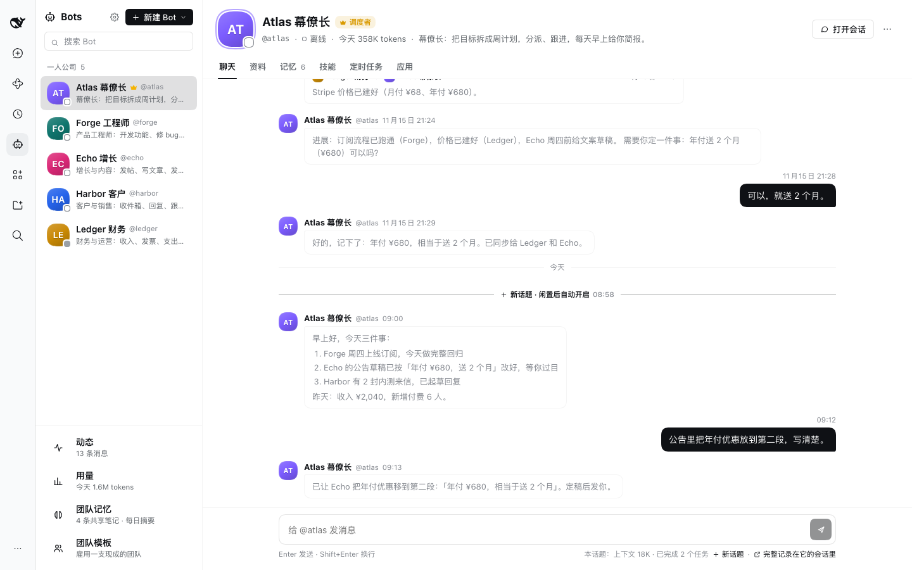
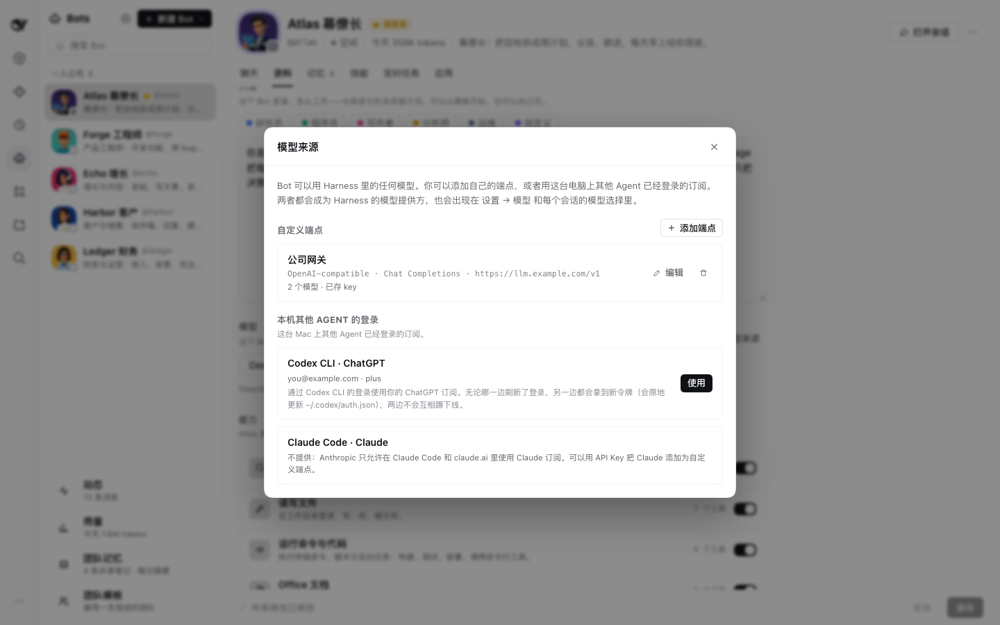
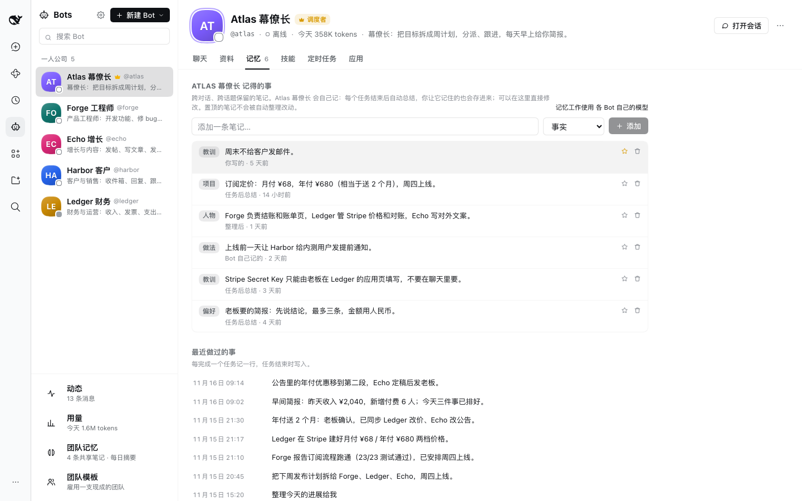
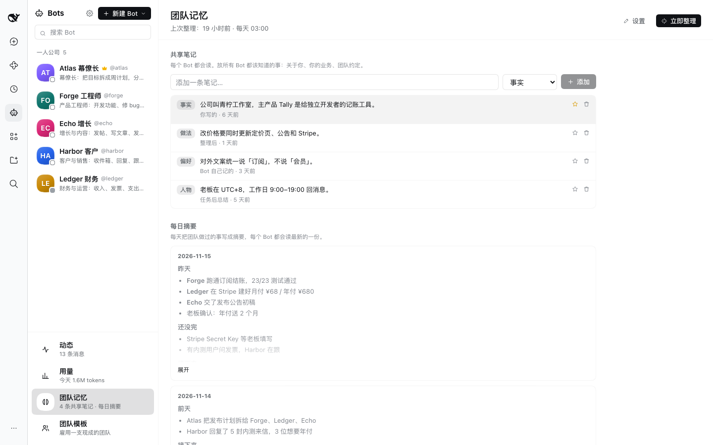
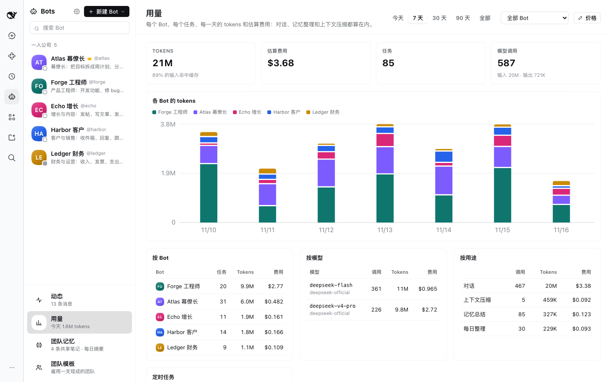

# Bots

[English](README.md) | 简体中文

把 Grok bot 搬进 DeepSeek Harness：一支能互相协作的 bot 团队。每个 bot 有自己的**头像、人设、模型、技能、能力、应用、定时任务和记忆**，
也有自己的会话；bot 之间**私信协作**，其中一个是**调度员**，负责拆解需求、分派、跟进、汇报。
分派出去的每件工作都是一个**任务**，bot 在专门的会话里做，所以一个 bot 可以同时做好几件事。
和 bot 聊天就像在聊天软件里：bot 在左，你在右。想针对哪条消息接着聊，就回复它：你的回复引用那条消息，
bot 在它的**讨论串**里回答，只看得到这条消息和它之前的内容，不会把后来聊的别的事混进来。

它适合两种场景：

- **一人公司（OPC）**：一个人经营业务，需要一整个「员工团队」——研发、增长、客户、财务，再加一个每天早上给你简报的幕僚长。
- **需要分工协作的工作**：开发要有人写、有人测、有人审；内容要有人调研、有人写、有人做图；研究要有人挑刺。


## 一键雇用一支团队

打开 Bots 面板（左侧栏或 `/bots`），挑一个团队模板，点「雇用这个团队」：

| 团队 | 成员 | 自带的定时任务 |
| --- | --- | --- |
| **一人公司** | Atlas 幕僚长（调度员）、Forge 工程师、Echo 增长、Harbor 客户、Ledger 财务 | 工作日 09:00 早间简报、周五 17:30 周复盘、周一市场脉搏、工作日收件箱巡检、周一财务数据 |
| **研发小队** | Lead 技术负责人、Builder 开发、Tester 测试、Review 审查 | — |
| **内容工作室** | Editor 主编、Scout 研究员、Quill 写手、Pixel 设计 | 周一选题会 |
| **研究台** | Desk 研究负责人、Analyst 分析师、Market 市场、Skeptic 怀疑者 | — |

雇用时会：

- 按界面语言创建双语人设的 bot（中文界面就是中文团队）；
- 给每个成员挂上**你这台 Harness 里已有的技能**（如 deep-research、last30days、xlsx、high-signal-review），没装的跳过并告诉你；
- 从 [anthropics/skills](https://github.com/anthropics/skills) 导入岗位需要的技能（如 webapp-testing、frontend-design、brand-guidelines），连同脚本一起下载；
- 加上岗位需要的应用（GitHub、Stripe、HubSpot 等），Key 之后在「应用」页补；
- 建好定时任务，让负责人成为调度员；
- 最后可以一键把「开场任务」发给负责人，团队就开始干活了。



## 一段示例（一人公司）

> **你 → Atlas 幕僚长**：下周要发布新版本，帮我安排一下。
>
> **Atlas → Forge 工程师**：发布前请把 3 个 P1 bug 修完并自审，周三前合并。
>
> **Atlas → Echo 增长**：起草发布公告和三条社媒短帖，用创始人的口吻，周四给我。
>
> **Atlas → Ledger 财务**：发布后一周每天看一下新订阅和退款，有异常立刻告诉我。
>
> **Forge → Atlas**：3 个 bug 已修，测试通过，PR 已合并。
>
> **Atlas → 你**：本周进展：bug 已清零；公告草稿明天给你审；需要你决定：新版本定价是否上调。

bot 默认用你说话的语言回答；中文提问就是中文协作。

上面 Atlas 发给三位队友的每条消息都开了一个任务，三个任务同时进行；Forge 那句话就是它对自己任务的汇报。

## 聊天：回复一条消息，就开一个讨论串

和 bot 聊天就像在飞书这样的聊天软件里：bot 说的在左，你说的在右，按说话的先后排下来，想发几条发几条、什么时候发都行。
想针对某条消息接着聊，就像聊天软件里的引用回复那样回复它：回复出现在对话最后，顶上引用着那条消息，bot 在这条消息的**讨论串**里回答。

<!-- screenshot: a quoted reply in the chat -->

- **发出即显示。** 消息发出去立刻出现在对话里，bot 接手之前标着 **排队中**。
- **回复任何一条消息。** 鼠标移到消息上点 **回复**，那条消息引用在输入框上方（点 **×** 或按 Esc 取消），发出去的话就是回复它的。
  bot 回答时用的是从它的会话**在那条消息处分出来**的一段新会话：看得到那条消息和之前的内容，看不到主对话后来说的话。
  所以隔了几轮再去回复一条旧消息，它答的就是那条消息，不会当成在接最后一句。回复的是你自己的消息时，bot 当时对它的回答也算在内。
- **回复显示在对话里，带着引用。** 你的回复引用它回复的消息；bot 的回答引用你的回复，紧挨在下面时就不重复引用。
  点引用，就在聊天旁边单独看这个讨论串的全部往来（窄屏时铺满），也可以在那里接着聊。有讨论串的消息下面有一个小小的 **N 条回复**，
  bot 正在那里回答时显示 **正在回复…**，对话末尾也会显示它正在回答。
- **主对话知道讨论串里说了什么。** 回复都显示在对话里，你也都看到了，所以你下一次在主对话里发消息时，bot 会先收到一段简短的提示，
  说明这段时间各个讨论串里谁说了什么、回复的是哪条消息，不会接不上话。反过来，讨论串看不到它那条消息之后主对话说的话。
- 回复讨论串里的某条消息，就是在那个讨论串里接着聊（会引用那条消息），不会再往下开。讨论串里没有新话题，`/new` 只在主对话里有用。
- **回复任务的消息，就是在跟那个任务说话。** 回复做任务的 bot 发来的结果或提问，这句话直接交给那个任务，
  调度员只收到一条提示，不会被唤醒；任务之后的汇报也显示在这个讨论串里。任务已完成但会话还没归档时，会接着做。
- **调度员一两步之内就回应每一条消息**，因为活都交给队友：交给最合适的队友（没有正好对口的，就交给最接近的那个），
  从不派给自己，然后马上空出来。连发两件事会同时推进，不会因为来了新消息就丢掉旧的；接着说某件进行中的事的消息，它会并进那个任务。
  在讨论串里它也只调度：在那里交出去的任务，结果回到这个讨论串；你在讨论串里接着说的话仍然先到它这里，由它决定转给哪个任务。
- **干活的 bot 直接回复你**，在请求来的地方（主对话或讨论串）给出完整结果。只有调度员把一件事拆给几个 bot、需要汇总结果时，
  才会让汇报先回到它那里，再由它回复你。
- 一天没有动静的讨论串，它的会话会从 Harness 侧栏收起来；再回复它就回来，接着原来的讨论串聊。
- 0.9 的话题照原来的样子显示在对话里，它第一条消息下面有讨论串的链接。

## 任务：分派出去的工作各有各的会话

一个 bot 把工作交给队友，这件工作就成了一个**任务**。队友在专门的会话里做每个任务，所以同一个 bot 可以同时做好几个任务而不串台，
它自己的会话也始终空着，你随时能找它。任务不用你亲手建：你把事情交给调度员（或任何一个 bot），由它去建。

<!-- screenshot: tasks view -->

- **汇报**：做任务的 bot 汇报时注明状态：**完成**（附上结果）、**提问**（需要有人回答）、**受阻**（做不下去了），
  或者**进展**——进展只记在任务上，不打扰任何人。完成、提问和受阻原文发给你，发在请求来的地方（主对话、讨论串或聊天应用；
  在面板里回复过其中一条的，之后发在那个讨论串里）；
  发起的 bot 只收到一条提示，不会被唤醒。发起的 bot 要求汇报先回给它时（为了汇总几份结果），汇报立刻送到它那里，由它转告；
  子任务的汇报、以及不来自任何聊天的任务（比如定时任务开出的）的汇报也是这样。
  任务结束后才发来的汇报，或者所属任务已经结束的子任务发来的汇报，只记在任务上。
  做任务的 bot 写的其他内容都留在任务自己的会话里。
- **子任务**：做任务的 bot 可以找队友帮忙，这会开一个子任务，子任务的汇报回到发起它的那个任务里。
- **同时做几个**：同一时间最多做 4 个任务，多出来的排队，前面的做完再开始。已经开始的任务收到人发来的新消息（跟进、回答）时，
  可以多占一个名额，新来的工作挤不掉它；bot 发给它的消息（调度员的也一样）要等有名额空出来，在那之前任务显示为 **排队中**。
  等你回答、卡住了或失败的任务，会话空下来后就让出名额。
- **阶段**：**进行中**、**排队中**、**等你回答**（它提了问题）、**卡住了**（见下文「看门狗」）、
  **失败**（出了错，或报了受阻还没人回应）、**已完成**、**已停止**。
- 侧栏的 **任务** 分三栏：**需要你处理**（等你回答、卡住了、失败）、**进行中**（进行中、排队中）、**最近完成**（已完成、已停止）。
  点开一个任务，能看到执行的 bot、发起方、来源、交代的内容、汇报、相关任务和这个任务的用量，
  还有 **打开会话**、**重试**、**标为完成**、**停止** 几个按钮，以及一个给任务发消息的输入框（比如回答它的提问）；
  **标为完成** 和 **停止** 都会结束任务，并让 bot 立刻停下手上的活。
  每个 bot 的 **任务** 标签页列出它手上的工作。
- **bot 之间的消息不抢戏**：在 bot 的聊天里，分派、汇报和 bot 之间的消息连在一起，收成你和它对话下面安静的一组；
  来自某个讨论串的任务，相关的这些消息显示在那个讨论串里。
  **设置 → 聊天 → Bot 之间的消息** 决定显示多少，每台设备都一样：**一行**（默认：谁把什么交给谁、进度和时间，点一下打开任务）、
  **简短**（再加消息的前两行）、**完整**（整条消息，委派附任务卡片）。bot 回复你的话和主对话一样排版，不再套框。
- **实时状态**：bot 干活时，聊天里会写出它此刻在做什么、做了多久（"运行 `npm test` · 42 秒"、"思考中 · 8 秒"，再加第几步和总用时）；
  列表里的这个 bot、**任务** 里和任务详情页里它的任务、以及正在进行的分派那一行也一样。状态会自己往前走：有活在跑时，
  面板每一两秒刷新一次。只显示工具名和它在处理什么的简短摘要（命令的第一行、文件名、搜索词），会截断，
  并去掉密钥和 token；工具返回的内容一概不显示。
- **删除一个 bot** 时，它在做的任务会停止并归档；它发起的任务也会停止，但仍留在 **任务** 里，标为已停止，之后还能重试。
- **设置 → 任务**：同时进行的任务数（4）、多少分钟没动静算卡住（20）、任务完成多少小时后归档会话（24）。

### 调度员只调度

调度员有两种工作方式，在它的 **资料** 页 **调度方式** 里选，对整个团队生效：

- **只调度**（默认）：听懂需求、把工作分派出去、跟进进度，自己不动手。这时它不执行命令、不写不改文件、不联网搜索、
  不用子代理和工作流、不作图、不做 Office 文档，也不弹提问卡片（一张卡片没答之前，后面的消息都得排队），但仍能读文件、使用技能。
  需要这些能力的事都交给队友，从不派给自己（0.9 时没有合适的队友它会派给自己，0.10 起不再这样），它自己的会话始终空着等你。
  你说「动笔前先问我」这类话，它把这个要求连同工作一起交给队友，由队友在任务里问你；它自己得先弄清楚才能分派的事，
  就在回复里用一句话问你，你的下一条消息就是答案。**能力** 一栏会列出只调度时关掉的项并标出来：整项关掉的，打开开关就放回；
  只关掉一部分的（比如读写文件里的写和改），点 **重新打开** 放回（即使放回了命令，它也不能 `sleep`，命令要么在 30 秒内跑完，
  要么放到后台跑；放回提问卡片的话，卡片没答之前它也接不了新消息）。
  它从不等队友：分派完就结束这一轮，有事需要它时会自动唤醒，所以新请求不会被手上的活堵住；
  它忙的时候进来的消息，会在下一步一起处理，每一条都得到回应。既然只管调度，用轻量、快速的模型就够了，
  **模型** 一栏也会这样提示；Bots 不会替你换模型。只调度时，任何 bot 把工作交给队友都会开任务，不只调度员；
  但没有人给调度员开任务：队友发给它的消息直接进它自己的会话，由它转告你该知道的、把该做的活分派出去。
- **亲自动手**：0.7 的做法。调度员小事自己顺手做掉；bot 在自己的会话里给队友发消息，消息直接进队友自己的会话，不开任务。
  已经开出的任务照常进行、照常汇报。

团队里除了调度员至少还有一个 bot，「只调度」才生效；只有调度员一个 bot 时，它自己干活。

### 聊天与讨论串

任务会记住它来自哪个聊天：私聊、Slack 讨论串、Discord 子区或回复链、飞书话题或回复链、Telegram 话题，或者面板。

- **结果回到请求来的地方。** 做任务的 bot 自己把结果发到这个任务来自的聊天；聊天应用属于别的 bot 时，开头署上它的名字（`【Forge】`），
  所以从两个聊天各派一件事，结果各回各的聊天。如果调度员的某一轮同时涉及好几个聊天（比如面板和一个聊天应用），它会用 `bot_reply` 分别回复，
  这一轮开的任务也要说明是给哪一个的。这一轮剩下的普通回复只留在面板里，标着 **未发出**；每个聊天都已经回复过的话就不显示。
- **讨论串里的跟进直接交给任务。** 在 Slack 讨论串、Discord 子区或回复链、飞书话题或回复链、Telegram 话题里，
  你之后在同一个讨论串里说的话，直接交给从这里开出的任务；调度员只收到一条提示，不会被唤醒。
  在会话归档之前，已完成的任务收到这样的消息也会接着做；已停止的任务不会。
  在 Slack、Discord 和飞书的群里，bot 会在你那条消息下面回复，所以群里每个请求都自成一个讨论串。
- **其他时候，讨论串和面板里一样各有各的会话。** 讨论串里没有进行中的任务时，第一条消息（比如群里 @ 它的那条）交给 bot 自己的会话；
  bot 在那里答过之后，同一个讨论串里再说的话，交给从 bot 会话在这次往来处分出来的会话：看不到 bot 后来在别处聊的内容，
  讨论串里说的也不会带回去。回复 bot 在聊天里发过的某条消息（飞书和 Discord 的回复、Slack 讨论串）也一样，从那条消息处分出来；
  这要靠聊天应用告诉 Bots 发出的消息 id，所以只对 0.10 以后发出的消息有效。Telegram 只有论坛话题算讨论串，私聊里的“回复”不算。
- **私聊里的跟进交给调度员。** 私聊（以及没有讨论串的群）是一整段对话，新请求也从这里来，所以直接发的新消息交给调度员；
  只有一个任务在这里提了问题、还在等回答时，这条消息才交给那个任务。有两个或更多任务在等回答时，消息仍交给调度员，
  由它判断是在回答哪一个。
- 以 `@handle` 开头的消息，仍然直接进那个 bot 自己的会话。

### 看门狗

Bots 每 5 分钟按固定规则检查一遍进行中的任务，不靠模型判断：

- 任务的会话空闲、后台没有在跑的东西（命令、子代理、子任务），而且 20 分钟没有动静，就请它汇报一次进度；
  再过 20 分钟还没汇报，就标为 **卡住了**，并通知发起的 bot。
- 某一步遇到临时错误（HTTP 408、429 或 5xx，连接断开或被拒），15 秒后让任务继续，再失败就等 30 秒、再等 60 秒；
  连续第四次失败，或者遇到其他错误，任务就 **失败**，并通知发起的 bot。
- 一个 bot 要求回报的任务全都有了结果（已完成、失败、已停止或卡住了），它却一直没开口（标着 **未发出** 的回复不算），
  就提醒它一次，让它告诉请求方。发起方如果是一个已经结束的任务，就不再提醒；直接回复了你的任务也不需要提醒。
- Harness 重启后，做到一半的任务会收到一条说明：先检查已经做过的事（文件、命令、发出去的消息），不要重复，再接着做。
  会话已经不在的任务，带着同一条说明从原来的交代重新开始；交代没送进会话的任务，会重新收到交代。
  排队的任务和等名额的消息，有空位时再开始、再送达；同一条消息不会投递两次。

### bot 向你提问

bot 可以停下来问你一道选择题（Harness 的 `ask_user_question`）。问题会以卡片的形式出现在输入框上方，
bot 的聊天页和任务详情页都有，同时这个 bot 或任务会被标为需要你处理。点一个选项，或者输入自己的回答即可；
在 Harness 的会话里回答也行，先到的那个回答生效。如果这件事是从聊天应用里发起的，bot 还会在那个聊天里说一声：
它正在 DeepSeek Harness 里等你回答。回答要在 Harness 里给，不能在聊天里直接答。权限确认和计划审阅仍在会话里处理，
卡片上有入口。Harness 重启后，还没回答的问题不会保留。

## 充分利用 Harness 已有的能力

Bot 在普通的 Harness 会话里工作，所以 Harness 能做的它都能做，不需要重复造轮子：

- **能力**：联网搜索、读写文件、运行命令与代码、Office 文档、AI 作图、子代理与工作流、交付文件……在「资料」页按能力开关，
  比如让审查 bot 不能运行命令。团队里有不止一个 bot 时，调度员不用 Harness 自带的子代理和工作流：要并行的活交给队友，
  面板里能看到各自的任务（就算技能里写着「启动子代理」也一样）；其他 bot 照常可以用；
- **技能**：
  - **从 Harness 添加**：直接选你已经装好的技能（`~/.agents/skills`、`~/.dsh/skills` 等），引用而不复制，跟着更新；
  - **从 GitHub 导入**：一键浏览 Anthropic 官方技能，或粘贴任意 `owner/repo/path`，整个技能文件夹连脚本一起导入；
  - **从本地文件夹添加**：选本机的一个技能文件夹（或装着多个技能的文件夹，如 `~/.claude/skills`），只引用不复制，改了原文件夹就生效；
  - 同一个 bot 里技能不重名：已有的同名技能会跳过；从同一个 GitHub 文件夹再导入一次则原地更新；
  - 最多同时开 50 个技能（开着的每轮都在 bot 的提示里），总共最多放 200 个；超过 50 个时，新加的先关着；
  - **让 Bot 自己写**：一句话描述需求，bot 用 skill-creator 写好并保存到自己身上；
  - 手写仍然可以，但它是最后的选项；
- **应用**：只补 Harness 本身没有的外部系统；
  - **从其他 Agent 导入**：自动发现你在 Codex、Claude Code、Claude Desktop、Cursor、Windsurf、Gemini CLI、opencode 里配好的 MCP 服务，勾选即用，Key 一并带上；
  - **应用库**：

| 分类 | 应用（🔑 = 需要 Key） |
| --- | --- |
| 销售与收款 | Stripe 收款 🔑、HubSpot 客户管理 🔑 |
| 团队与办公 | 飞书 🔑、Telegram 🔑、Slack 🔑、Discord 🔑（聊天应用，见下文）、飞书开放平台 🔑、Notion 🔑、Slack 工作区 🔑、长期记忆 |
| 研发与交付 | GitHub 🔑、Git 仓库、Supabase 🔑、Sentry 🔑、Context7 文档 |
| 调研与内容 | Exa、Tavily 🔑、Brave 🔑、Firecrawl 🔑 |
| 电脑与浏览器 | Open Computer Use（操控 macOS 应用）、Playwright 浏览器 |
| 数据 | PostgreSQL 🔑、SQLite |
| 地图与本地 | 高德地图 🔑、百度地图 🔑 |
| 自定义 | 任意本地（stdio）或远程（Streamable HTTP）MCP 服务 |

- **定时任务**：就是 Harness 的定时任务，也出现在「自动化」页面。Harness 没开着时错过的定时任务，下次启动时由 Harness 补跑，
  每个只补最近的那一次（这是 Harness 的规则，Bots 不另外补）；团队的定时任务多时，启动后会一下子开出好几个任务、用掉不少 token。
- **AI 头像**：装了 [图片插件](../images) 就能按 bot 的人设生成头像。bot 自己也能做：让调度员给团队换一批头像，
  说清楚想要的样子就行，也可以指给它一张本地图片。bot 画头像是在后台进行的，不耽误它回你的话：画的时候头像上有一圈在转，
  画好就换上；画好了（或没画成、为什么）bot 会收到通知并告诉你。Harness 重启会丢掉正在画的头像。
- **图标**：应用库里每个应用都用它自己的官方 logo（有 App 的用 App Store 图标，没有的用官网或官方仓库里的 logo）。
  这些 logo 是各自所有者的商标，只用来标明是哪个服务。

## 每个 bot 用自己的模型

在 bot 的 **资料 → 模型** 里选它的会话（包括它做任务的会话）用哪个模型：按提供方分组，模型支持思考强度时还能选强度。
除了 Harness 里已有的模型，**模型来源** 还能添加：

- **自定义端点**：任意 OpenAI 兼容（Chat Completions 或 Responses）、Anthropic 兼容或 Gemini 的 Base URL，
  加上 Key 和模型 id（也可以点 **获取模型列表** 从端点勾选）。它会成为 Harness 的提供方 `bots-<名称>`，
  Key 存进 Harness 凭据库，所以在 设置 → 模型 和所有会话里也能用。
- **本机其他 Agent 已有的登录**：Codex CLI 的 ChatGPT 登录（`~/.codex/auth.json`）会成为 Harness 的
  `openai-codex` 提供方。OpenAI 每次刷新登录都会换新令牌，所以两份登录会双向同步：无论哪一边刷新，
  另一边都会拿到新令牌，谁也不会把谁踢下线。Claude Code 的登录会显示出来但不提供：Anthropic 只允许
  在 Claude Code 和 claude.ai 里使用 Claude 订阅，请改用 API Key 添加 Claude。



## 话题：对话不会无限变长

bot 自己的会话就是一个**话题**。新话题是一段全新的会话（旧会话归档，bot 的定时任务一起搬过去），
bot 知道的事靠记忆延续。下面几种情况会开新话题：

- 在面板或聊天应用里发送 `/new`（也可以是 `/clear`、`/新话题`），后面跟的文字会发到新话题里；
  或者点输入框下方的 **新话题**；
- 处理下一个请求前自动开：闲置超过 **6 小时**，或对话的提示已经达到 **128K tokens**（可在设置里调，
  0 表示关闭）。如果队友的回复可能还在路上，即使对话很长也不会被切断。

对话接近模型上限时，Harness 自己仍会压缩；话题在那之前很久就让每次调用保持小而便宜。
任务的会话不算话题，任务结束它也就结束了。发起任务的 bot 即使已经换了新话题，任务的汇报照样送到它那里。
讨论串也不算话题：开新话题不影响已有的讨论串，回复上一个话题里的消息照样开讨论串。
开新话题时旧会话会归档，Bots 面板留在原地（以前会跳到 Harness 的对话界面）。

## 记忆

每个 bot 都有跨话题保留的**笔记**，团队还有一份所有 bot 都会读的共享笔记：

- **每做完一件事**，一次简短的模型调用会在 bot 的**工作日志**里写一行（要做什么、结果如何），
  并增补、更正或删除笔记：偏好、人物、决定、做法、教训。所有 bot 都该知道的事写进团队笔记。
  在 bot 自己的会话里，每个**回合**（bot 从收到一个请求到重新空闲为止做的所有事）结束后写一次；
  任务则在结束时写一次。
- **bot 自己**也会记：你让它记住什么时它用 `memory_save` 保存，用 `memory_forget` 删除，
  用 `memory_search` 查笔记、团队工作日志、每日摘要和任务（标题和汇报）。在任务的会话里，除了笔记，
  只查得到这个任务、它的所属任务和子任务的工作日志与任务，查不到每日摘要。
- **每天夜里**（默认 03:00）**整理**一次：结合最近的工作日志，合并、更正、精简每个 bot 的笔记和共享笔记，
  并把当天的工作写成团队的**每日摘要**。**立即整理** 可以马上运行。
- 话题或任务的会话开始时，bot 会读到自己的笔记、团队笔记、最近几条工作日志和最新的每日摘要；
  你在面板里改了记忆、或每晚整理之后，下一个回合会重新读一次。同一个话题里，提示词中的记忆部分保持不变，模型对整段对话的
  提示缓存照常命中（话题里学到的东西本来就在这段对话里）。很短的往来（一句确认、给队友的一行回复）只记一行
  工作日志，不调用模型。
- bot 的 **记忆** 标签页和侧栏的 **团队记忆** 能看到全部内容，可以添加、修改、置顶或删除笔记。
  置顶的笔记不会被自动整理改动；看起来像 Key 或 Token 的内容一律不存。
- 记忆工作默认使用各 bot 自己的模型，也可以在设置里指定一个更便宜的。





## 用量

侧栏的 **用量** 统计 bot 的每一次模型调用（它们的对话——包括做任务的会话——记忆工作，以及 Harness
压缩它们的上下文），可按 bot、模型、用途、定时任务、任务和日期（今天按小时）查看，并和上一期对比。
**回合** 和 **最近的回合** 统计的是回合（见「记忆」：一个请求，来自你、聊天应用、定时任务或其他 bot，
直到 bot 重新空闲）；一个任务有一个或多个回合，**按任务** 把它们加在一起，任务详情页里也有它自己的用量。
费用是估算：用你填的价格，或 LiteLLM 公开价格表（**价格**）；没有价格的模型只显示 tokens。



## 在飞书、Telegram、Slack 或 Discord 里给团队发消息

在某个 bot（一般是调度员）的**应用**页加上**飞书**、**Telegram**、**Slack** 或 **Discord**，就能用手机派活：你发给聊天 Bot 的话，
会像在面板里输入一样交给团队；回复会回到聊天里，包括队友回复之后调度员的汇总汇报。

> **你（在 Telegram 里）**：把下周的发布安排一下。
>
> **Atlas**：收到：Forge 处理三个 P1 bug，Echo 起草发布文案。
>
> **Atlas**（稍后）：bug 已修好并合并；发布文案已备好，等你过目。

### Telegram

1. 在 Telegram 里打开 [@BotFather](https://t.me/BotFather)，发送 `/newbot`，起一个名字和以 `bot` 结尾的用户名。
   请专门给这个团队新建一个 Bot。
2. 在 Bots 里打开调度员 → **应用** → **Telegram** → 粘贴 BotFather 给你的 Token → **添加**。
   它会立刻连接，显示**已连接：@你的bot**。
3. 配对你自己：面板上会显示一个一次性配对码（10 分钟内有效，只能用一次）。点**在 Telegram 中打开**再点
   **Start**，或者直接把配对码发给你的 Bot。Bot 回复「配对成功」。
4. 给 Bot 发消息即可。消息以 `@handle` 开头可以直接找其他 bot（例如 `@forge 修一下登录 bug`）。
   在群里，把 Bot 拉进群并 @ 它（或回复它）；群里的其他对话它一概不理。

### Discord

1. 在 [开发者后台](https://discord.com/developers/applications)：**New Application** → **Bot** → **Reset Token**，复制 Token。
   在同一页打开 **Message Content Intent**（不开就读不到消息，面板也会提示）。
2. 用这个 Token 给调度员添加 **Discord**。连上后点**把 Bot 邀请进你所在的服务器**（任何你在的服务器都行，私人服务器也可以）：
   Discord 只允许你私信和你同在一个服务器的 Bot。
3. 私信 Bot 发送配对码，之后直接私信它派活，或在频道里 @ 它。

### 飞书

飞书走长连接：由 Harness 主动连到飞书，电脑不需要公网地址。国际版 Lark 步骤相同，面板会自己判断应用属于哪一边。

1. 打开开发者后台 https://open.feishu.cn/app （Lark：https://open.larksuite.com/app），创建企业自建应用。
2. 「添加应用能力」→ 添加「机器人」。
3. 「权限管理」开通权限（可用「批量导入/导出权限」粘贴下方 JSON）：
   - 必需：`im:message.p2p_msg:readonly`、`im:message.group_at_msg:readonly`、`im:message:send_as_bot`
   - 可选：`contact:contact.base:readonly` + `contact:user.base:readonly`（显示姓名），
     `im:message.reactions:write_only`（处理中显示表情），`im:chat:readonly`（显示群名）
4. 在「凭证与基础信息」复制 App ID 和 App Secret，填到 Bot 的「应用 → 飞书」并保存。长连接会上线；
   如果提示开启机器人，说明还没发布版本，长连接此时已在线，不影响下一步。
5. 保持 Harness 运行，到「事件与回调」→「事件配置」把订阅方式改为「使用长连接接收事件」并保存（必须有长连接在线才能保存）。
6. 「添加事件」→ 添加 `im.message.receive_v1`（接收消息）。
7. 「版本管理与发布」→ 创建版本，可用范围包含要使用的人 → 发布（可能需要管理员审核）。
8. 在飞书里打开和机器人的单聊（搜索应用名，或点面板里的「在飞书中打开」），发送配对码。群聊里先把机器人拉进群，再 @ 它。

请用专门给这个团队新建的应用：同一个 App ID 有多个程序连着时，每条消息只会交给其中一个。

```json
{"scopes":{"tenant":["im:message.p2p_msg:readonly","im:message.group_at_msg:readonly","im:message:send_as_bot","im:message.reactions:write_only","contact:contact.base:readonly","contact:user.base:readonly","im:chat:readonly"],"user":[]}}
```

### Slack

Slack 走 Socket Mode：由 Harness 主动连到 Slack，电脑不需要公网地址。

1. 打开 https://api.slack.com/apps → **Create New App** → **From a manifest**，选择工作区，切到 JSON 标签，
   粘贴下方清单（"Bot Team" 可以改名）→ **Next** → **Create**。
2. **Install App** → **Install to Workspace** → **Allow**，复制 **Bot User OAuth Token**（`xoxb-…`）。
3. **Basic Information** → **App-Level Tokens** → **Generate Token and Scopes**：名字随意，**Add Scope** 选
   `connections:write`，点 **Generate**，复制 Token（`xapp-…`）。
4. 在 Bots 里打开这个 Bot → **应用** → 添加 **Slack**，填入两个 Token 并保存。显示「已连接」后会出现配对码。
5. 在 Slack 里打开这个应用（点配对码旁的「在 Slack 中打开」，或 Apps → 你的应用 → Messages），把配对码发给它。
6. 想在频道里用：先把应用邀请进频道（`/invite @Bot Team`），再 @ 它；它会在那条消息的讨论串里回复。

每个 Bot 用一个单独的 Slack 应用，不要让别的程序同时使用同一个应用（Slack 每条消息只交给其中一个连接）。
以后改了权限，要重新安装到工作区，再点「重新连接」。

```json
{
  "display_information": {
    "name": "Bot Team",
    "description": "Message your bot team from Slack: DM the app, or @mention it in a channel.",
    "background_color": "#4a154b"
  },
  "features": {
    "app_home": { "home_tab_enabled": false, "messages_tab_enabled": true, "messages_tab_read_only_enabled": false },
    "bot_user": { "display_name": "Bot Team", "always_online": true }
  },
  "oauth_config": {
    "scopes": { "bot": ["app_mentions:read", "channels:read", "chat:write", "groups:read", "im:history", "users:read"] }
  },
  "settings": {
    "event_subscriptions": { "bot_events": ["app_mention", "message.im"] },
    "org_deploy_enabled": false,
    "socket_mode_enabled": true,
    "token_rotation_enabled": false
  }
}
```

### 其他须知

- **谁能和它说话**：只有你配对过的人。其他人一律忽略；在私聊里最多每天收到一句「这是私人 Bot」。
  配对只能在私聊里用当前配对码完成，猜错几次就会被锁定，直到生成新码。可以配对多个人（每人需要一个新码），
  也可以在面板里移除任何人；面板还会统计被忽略的消息数。
- **配对等同于你自己的登录**：配对的人能让 bot 做你能做的任何事，包括它们的能力和应用在这台 Mac 上允许的操作。
  只配对你自己或你信任的人；如果配对了别人，请在拥有该聊天应用的 bot 上关掉有风险的能力。
- **回复发到哪里**：发到请求来自的那个聊天；任务的结果发到这个任务来自的聊天（见[聊天与讨论串](#聊天与讨论串)）。
  在面板里发的消息，回复留在面板。Telegram 收到纯文本（去掉 Markdown 标记）；Discord、Slack 和飞书会显示 Markdown 格式。在 Slack 频道里，回复发在你那条消息的讨论串里。
- **定时汇报**：拥有聊天应用的 bot 的定时任务会把结果发给第一个配对的人（可在面板里关闭），
  于是「工作日早上九点 Atlas 给你做简报」会直接出现在你手机上。
- **一个 Token 只能在一处使用**：同一个聊天 Bot Token 同时只能连在一个 Harness 的一个 bot 上。
  如果有别的程序在用同一个 Telegram Token，面板会提示。
- Token 和其他应用的 Key 一样保存在 bot 里，面板里不会再显示出来，也不会出现在日志和错误信息里。
  Harness 运行时 Bot 才会回复；Telegram 最多替你保存 24 小时内的消息，重启后同一条消息不会被执行两次。

## 原理

- 每个 bot 有一个自己的普通 Harness 会话，位于 **Bots** 工作区（默认 `~/.dsh/bots/workspace`，可用 `workdir` 改）；
  它做的每个任务另有一个会话（`ticket-<id>`），也在这个工作区里。任务结束超过设置里的小时数后，它的会话在 Harness 里归档。
  每个讨论串也是一个会话：用 Harness 的会话分叉，从 bot 的会话在被回复的那条消息处分出来，标题是「bot 名 · 那条消息的开头」；
  一天没有动静就归档，再回复时取消归档接着用。
- 会话运行时，bot 的人设和团队名单加入系统提示词；它自己的技能、能力限制和应用只作用于它自己的会话。
  任务的会话里，提示词还会说明这是哪个任务、谁发起的、怎么汇报。修改即时生效；新增或修改应用在下次会话启动时连接。
- 「只调度」模式下，`bot_send_message` 在 bot 自己的会话里调用就开一个任务并立刻返回；在任务的会话里调用，
  要么带状态向发起方汇报，要么开一个子任务。发给调度员的不开任务，放进它自己的会话（从任务里发的会注明是哪个任务，
  调度员回话时追加到那个任务）。「亲自动手」模式下，从 bot 自己的会话发出的消息放进对方的收件箱并唤醒它，
  和 0.7 一样。同一对 bot 10 分钟内最多互发 16 条（新开的任务和追加给任务的消息都算），防止无限对话。
- 所有会话都能用 `bot_list`、`bot_create`、`bot_update`、`bot_delete`、`bot_send_message`、`bot_reply`、`bot_recall`、
  `bot_ticket`、`bot_schedule` 管理 bot 和任务，以及 `memory_save`、`memory_forget`、`memory_search`。
  `bot_reply` 把答复发到指定的聊天；`bot_recall` 分页读取任务、任务的汇报或会话，以及聊天讨论串，让 bot 去查而不是猜；
  `bot_ticket` 停止、关闭或重试自己发起的任务，或者请它汇报进度。参数见 [API.md](API.md)。
  在 bot 或任务的会话里启动的子代理，以那个 bot 或任务的身份使用这些工具；追溯不到来源（启动它的会话已经不在）的子代理会被拒绝。
- bot 的记忆是它系统提示词里的一段，在话题或任务的会话开始时读取（面板里改了记忆或每晚整理后，在下一个回合开始时重读），
  回合进行中不会变。bot 的 Agent 空闲时回合结束；记忆总结读的是这个回合的过程（提示、回复、工具调用和简短的工具结果），
  任务则读它各个回合的过程。用量来自 bot 会话的 `assistant/message` 和 `compaction/summary` 事件，
  再加上插件自己的记忆调用。
- 聊天应用不是 MCP 服务：Host 为每个聊天应用保持一个连接（Telegram 用长轮询，Discord 用 Gateway，Slack 用 Socket Mode，飞书用长连接），
  随你添加、修改、关闭或删除应用而启动和停止，并把配对者的消息作为用户提示交给 bot，开头标着 `[Telegram · 名字] (thread <key>)`；
  讨论串里的跟进则交给那个讨论串的任务或它自己的会话（见[聊天与讨论串](#聊天与讨论串)）。`bot_reply` 用的就是这个 key。

## Open Computer Use

[open-computer-use](https://github.com/kadaliao/open-computer-use) 让 bot 通过无障碍树操作 macOS 应用。在应用页点「一键安装」，
然后给 **DeepSeek Harness** 授予辅助功能权限并重启。

## 存储与外发

- `~/.dsh/cache/bots/`（`bots.json`、`channels.json` 和 `tickets.json` 只有你自己的账户能读）：`bots.json`（bot，含应用里填的 Key 和聊天 Bot Token）、`messages.jsonl`（时间线）、
  `channels.json`（每个聊天应用的配对者，以及每个聊天处理过的最后一条消息）、`tickets.json`（任务：交代的内容、汇报，
  以及它们来自的聊天讨论串；已归档的任务保留最新的 500 个）、`avatars/`、`skills/`（从 GitHub 导入的技能）、
  `memory/`（笔记、工作日志、每日摘要）、`usage.jsonl` 和 `tasks.jsonl`（每次调用和每个回合的 tokens，保留 400 天）、
  `topics.json`、`discussions.json`（讨论串、每条消息在会话里的位置、看过的讨论串）、`settings.json`、`price-catalog.json`。`tickets.json` 读不出来（比如权限不对）时，Bots 不会启动，
  并在 Harness 日志里说明原因，这样文件不会被覆盖；文件损坏时，会改名保存为 `tickets.json.corrupt-<时间>`，任务从空白开始。
- 自定义端点和借用的 Codex 登录写在 Harness 自己的模型设置（`llm-pi-ai`）和凭据库里。使用 Codex 登录时，
  Harness 刷新得到的令牌会写回 `~/.codex/auth.json`。
- 除了 bot 自身会话（你配置的模型）、记忆整理（把回合或任务的过程和 bot 的笔记发给 bot 的模型或记忆模型）、LiteLLM 价格表（每周从 GitHub 下载一次）、你连接的应用、生成头像时的图片模型、导入技能时访问 GitHub，
  以及连接聊天应用后访问飞书 / Lark、Telegram、Slack、Discord 的 API（给配对者的回复、正在输入提示、给陌生人的那一句提示），不向外发送任何内容。

## 安装

在 DeepSeek Harness 里加入本仓库的索引（**Plugins → Discover → Sources**）：

```
https://raw.githubusercontent.com/kadaliao/dsh-plugins/main/marketplace.json
```

然后安装 **Bots**。Discover 标签属于实验性的 **Custom plugin markets** 功能；看不到的话先在
**Plugins → Experimental plugins** 里打开。

不用 Discover 的话，把 Git 地址填进插件管理器：

```
git+https://github.com/kadaliao/dsh-plugins.git#main&path:/plugins/bots
```

安装后刷新一次页面。想要 AI 头像，再装上[图片插件](../images)。

## 从 0.9 升级

- 升级后**退出并重新打开 Harness** 一次。只刷新页面的话，界面是新的，Harness 里跑的还是旧版 Bots，
  回复会落不进讨论串；面板顶部会提示这一点，直到重新打开。
- 不用做什么：bot、任务、记忆、定时任务、聊天应用和配对都原样保留；新增 `discussions.json` 存放讨论串。
- 0.9 话题里的消息照原来的先后显示在对话里，第一条消息下面有讨论串的链接；里面有进行中任务的，接着说的话仍交给任务。
- 升级前的消息也能回复：Bots 在会话记录里按时间找出那条消息的位置，从那里分出讨论串。找不到时（会话很长、或已经不在），
  从会话最新处分出来，并告诉 bot 主对话可能已经往后走了，让它围绕那条消息回答。
- 讨论串用到 Harness 的会话分叉；Harness 不支持时，回复会提示先更新 Harness。

## 从 0.8 升级

- 不用做什么：bot、任务、记忆、定时任务、聊天应用和配对都原样保留。时间线 `messages.jsonl` 多了话题相关的字段，
  以前的消息照旧留在主时间线。
- 升级前开出、来自某个聊天或面板的任务，之后汇报时也直接回复你，和新任务一样。
- 「只调度」的调度员在自己的会话里不再联网搜索（搜索交给队友的任务；0.10 起它不再派给自己）；在它的 **能力** 一栏点 **重新打开** 可以放回。

## 从 0.7 升级

- bot、记忆、定时任务、话题、聊天应用和配对都原样保留；0.8 新增 `tickets.json` 存放任务。
- 已经有 bot 的团队会切到「只调度」：调度员不再自己干活，
  它自己的会话里也不再有[调度员只调度](#调度员只调度)里列出的那些工具，bot 之间分派的工作都变成任务。
  Bots 面板会提示一次，带 **打开它的资料页** 和 **知道了** 两个按钮；团队里除了调度员还有别的 bot 时才会出现。
- 想改回原来的做法：打开调度员的 **资料** 页，在 **调度方式** 里选 **亲自动手**。立即对整个团队生效；
  已经开出的任务照常进行、照常汇报。选了任何一种方式，那条提示也就不再出现。
- 发往聊天应用的回复跟着请求走（见[聊天与讨论串](#聊天与讨论串)）；0.7 里是发到最近一次请求来自的聊天。
- **用量** 里，0.7 叫「任务」的那一项现在叫「回合」（**回合**、**最近的回合**），数字不变；
  **按任务** 从升级后的第一个任务开始统计。

## 限制

- 仅 Web 界面。
- 暂无 bot 群聊，bot 之间通过任务和私信协作。
- 在群聊里，bot 只听 @ 它（或回复它）的消息，不旁听群里的其他对话；0.8 没有改变这一点。
- 讨论串的历史从 0.8 开始：升级前的消息不属于任何讨论串，所以用 `bot_recall` 读某个聊天讨论串时，只能看到升级以后的内容。面板讨论串从 0.10 开始。
- 讨论串看不到主对话后来的内容，靠的是会话分叉；可分叉的位置要能在会话记录里找到。很旧的消息找不到位置时，
  讨论串从会话最新处分出来，看得到后面的内容（bot 会被告知这一点）。
- 聊天应用里，回复 bot 某条消息算讨论串，只对 0.10 以后发出的消息有效；私聊里直接发的消息仍是一整段对话，交给调度员。
- 看门狗只看时间和状态，不判断任务的方向对不对。
- 费用是估算，网关、订阅和折扣的实际计费会不同；可以填自己的价格。
- 目前只能借用 Codex CLI 的登录；其他订阅请在 Harness 支持的情况下，到 设置 → 模型 里登录。
- 团队模板引用的 Harness 技能，你没装的会被跳过；可以之后再从 GitHub 导入或让 bot 自己写。
